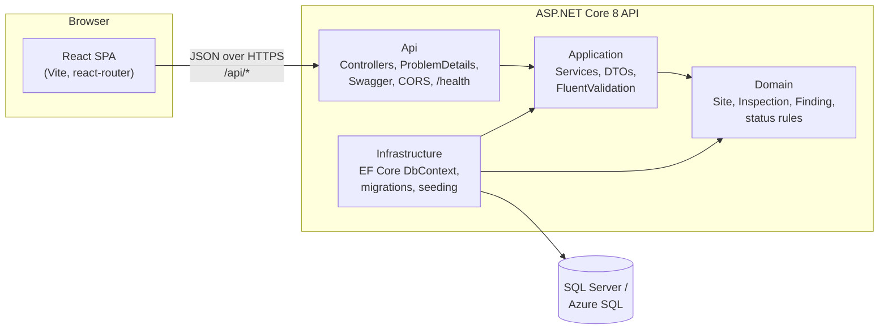
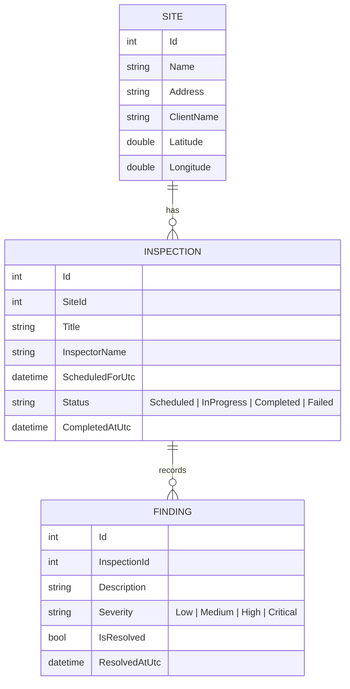

# Site Inspection Tracker

Site Inspection Tracker is a full-stack web application for planning and following up inspections on construction and industrial sites. Teams register **sites**, schedule **inspections** with an inspector and date, move them through a simple workflow (Scheduled → In progress → Completed / Failed) and record **findings** with a severity so open issues can be tracked until they are resolved. An ASP.NET Core 8 REST API with EF Core and SQL Server holds the data, and a React + TypeScript single-page app provides a dashboard and the day-to-day screens. The repository also contains Docker files for local use, a GitHub Actions CI pipeline and a Bicep template for Azure App Service, Azure SQL Database and Azure Static Web Apps.

## Features

- **Sites**: create, edit, delete and search (name, address or client), with per-site inspection and open-finding counts. Site names are unique, and a duplicate returns `409 Conflict`.
- **Inspections**: schedule, edit and delete, filtered by site, status, inspector and date range. Status changes are enforced by a domain state machine, and illegal transitions return `409 Conflict`.
- **Findings**: severity levels Low / Medium / High / Critical, resolve or reopen, filtered by site, inspection, exact or minimum severity and resolved state.
- **Dashboard**: totals, inspections per status, open findings per severity and the next upcoming inspections.
- **API quality**: pagination on every list endpoint (`page`, `pageSize`, max 100), FluentValidation with `400 ValidationProblemDetails`, RFC 7807 `ProblemDetails` for 404/409/500 with a `traceId`, Swagger / OpenAPI with XML doc comments, CORS for the client, and a `/health` endpoint that includes a database check.
- **Data**: EF Core 8 code-first migrations for SQL Server, enums stored as strings, indexes on common filters, cascade deletes, UTC timestamps and optional demo seed data.
- **Client**: React 18 + TypeScript + Vite, react-router, a typed `fetch` API client, severity and status badges, and accessible forms with client-side validation.

## Tech stack

| Layer | Technology |
| --- | --- |
| API | ASP.NET Core 8 Web API (controllers), Swashbuckle, FluentValidation |
| Data | Entity Framework Core 8, SQL Server 2022 / Azure SQL Database |
| Client | React 18, TypeScript 5, Vite 5, React Router 6 |
| Tests | xUnit, `WebApplicationFactory`, EF Core SQLite (in-memory), Vitest, Testing Library |
| DevOps | Docker, docker compose, nginx, GitHub Actions |
| Cloud | Azure App Service (Linux), Azure SQL Database, Azure Static Web Apps, Bicep |

## Architecture

The backend follows a layered (clean architecture style) structure. Dependencies point inward: the Domain has no dependencies, and the Application layer depends only on the Domain plus an `IApplicationDbContext` abstraction that Infrastructure implements.



**Request flow:** a controller receives a request and calls an application service. The service validates the DTO, loads aggregates through `IApplicationDbContext`, applies domain behaviour (for example `Inspection.ChangeStatus`) and returns a DTO. Domain and application exceptions are mapped to ProblemDetails by a single `IExceptionHandler`.

### Domain model



## Project structure

```
site-inspection-tracker/
├── src/
│   ├── SiteInspectionTracker.Domain/          # Entities, enums, invariants, status state machine
│   ├── SiteInspectionTracker.Application/     # Services, DTOs, validators, paging, exceptions
│   ├── SiteInspectionTracker.Infrastructure/  # EF Core DbContext, configurations, migrations, seeding
│   └── SiteInspectionTracker.Api/             # Controllers, exception handler, Program.cs, Dockerfile
├── tests/
│   ├── SiteInspectionTracker.UnitTests/        # Domain, validator and service tests (SQLite in-memory)
│   └── SiteInspectionTracker.IntegrationTests/ # HTTP tests via WebApplicationFactory + SQLite
├── client/                                    # React 18 + TypeScript + Vite SPA, Dockerfile, nginx.conf
├── infra/                                     # main.bicep + main.bicepparam (Azure)
├── .github/workflows/ci.yml                   # Build and test pipeline
└── docker-compose.yml                         # SQL Server 2022 + API + client
```

## Running locally

### Option 1: Docker Compose (everything in containers)

```bash
docker compose up --build
```

| Service | URL |
| --- | --- |
| React client (nginx, proxies `/api` to the API) | http://localhost:3000 |
| API + Swagger UI | http://localhost:5080/swagger |
| Health check | http://localhost:5080/health |
| SQL Server | `localhost,1433` (user `sa`) |

The API applies migrations and seeds demo data on startup. The SA password in `docker-compose.yml` (`Your_strong_password123`) is a throw-away example for local development only.

### Option 2: .NET SDK + Node (hot reload)

Prerequisites: .NET 8 SDK, Node.js 20+, and a SQL Server instance. The simplest way to get one is to start only the database container:

```bash
docker compose up -d sqlserver
```

Run the API. The connection string is kept out of source control with user secrets:

```bash
dotnet user-secrets --project src/SiteInspectionTracker.Api set ConnectionStrings:DefaultConnection \
  "Server=localhost,1433;Database=SiteInspectionTracker;User Id=sa;Password=Your_strong_password123;TrustServerCertificate=True"

dotnet run --project src/SiteInspectionTracker.Api      # http://localhost:5080/swagger
```

In the `Development` environment the API applies pending migrations and seeds demo data automatically (`Database:ApplyMigrationsOnStartup` and `Database:SeedSampleData` in `appsettings.Development.json`).

Run the client in a second terminal. The Vite dev server proxies `/api` and `/health` to `http://localhost:5080`:

```bash
cd client
npm install
npm run dev                                            # http://localhost:5173
```

### Database migrations

The EF Core CLI is pinned as a local tool:

```bash
dotnet tool restore
dotnet ef migrations add <Name> \
  --project src/SiteInspectionTracker.Infrastructure \
  --startup-project src/SiteInspectionTracker.Api
```

## Running the tests

```bash
# Backend: unit + integration tests (no SQL Server required, they use SQLite in-memory)
dotnet test

# Frontend: type-check/build and Vitest
cd client
npm ci
npm run build
npm test
```

- **Unit tests** (`tests/SiteInspectionTracker.UnitTests`) cover domain invariants and the inspection status state machine, FluentValidation rules, and the site, inspection, finding, dashboard and seeding services. They run against a real EF Core model on SQLite in-memory.
- **Integration tests** (`tests/SiteInspectionTracker.IntegrationTests`) start the full API with `WebApplicationFactory`, replace SQL Server with SQLite in-memory and exercise HTTP endpoints end to end: status codes, ProblemDetails bodies, pagination, filtering, the inspection workflow, the dashboard, CORS, Swagger and `/health`.
- **Client tests** (Vitest + Testing Library) cover the typed API client (query strings, error mapping), the inspection form's validation, the findings table, the severity badge, formatting helpers and the dashboard page.

CI (`.github/workflows/ci.yml`) runs all of the above on every push and pull request to `main`. It also fails if the EF Core model has changes that have no migration, and builds both Docker images.

## API endpoints

All list endpoints accept `page` (default 1) and `pageSize` (default 20, max 100) and return `{ items, page, pageSize, totalCount, totalPages, hasNextPage, hasPreviousPage }`. Enums are serialized as strings.

| Method | Route | Description |
| --- | --- | --- |
| GET | `/api/sites?search=` | List sites (search matches name, address or client) |
| GET | `/api/sites/{id}` | Get a site |
| POST | `/api/sites` | Create a site → `201 Created` (`409` if the name exists) |
| PUT | `/api/sites/{id}` | Update a site |
| DELETE | `/api/sites/{id}` | Delete a site and its inspections/findings → `204` |
| GET | `/api/inspections?siteId=&status=&inspector=&from=&to=` | List inspections with filters |
| GET | `/api/inspections/{id}` | Get an inspection with its findings |
| POST | `/api/inspections` | Schedule an inspection → `201 Created` |
| PUT | `/api/inspections/{id}` | Update details/status (`409` on an illegal transition) |
| DELETE | `/api/inspections/{id}` | Delete an inspection → `204` |
| GET | `/api/inspections/{id}/findings` | List the findings of an inspection |
| POST | `/api/inspections/{id}/findings` | Record a finding → `201 Created` |
| GET | `/api/findings?siteId=&inspectionId=&severity=&minSeverity=&isResolved=` | List findings across sites |
| GET | `/api/findings/{id}` | Get a finding |
| PUT | `/api/findings/{id}` | Update a finding / mark resolved |
| DELETE | `/api/findings/{id}` | Delete a finding → `204` |
| GET | `/api/dashboard/summary` | Counts per status and severity, upcoming inspections |
| GET | `/health` | Health check (includes database connectivity) |

Example:

```bash
curl "http://localhost:5080/api/inspections?status=Scheduled&page=1&pageSize=10"

curl -X POST http://localhost:5080/api/inspections \
  -H "Content-Type: application/json" \
  -d '{"siteId":1,"title":"Scaffold safety check","inspectorName":"Alex Chen","scheduledForUtc":"2026-12-01T09:00:00Z"}'
```

Interactive documentation is available at `/swagger` in Development, or wherever `Swagger:Enabled` is `true`.

## Deploying to Azure

`infra/main.bicep` deploys into an existing resource group:

- **App Service plan (Linux, B1 by default) + Web App** running the API on the .NET 8 runtime, HTTPS only, with the `/health` health check and a system-assigned managed identity.
- **Azure SQL logical server + database** (Basic tier by default). The connection string is injected into the Web App as `DefaultConnection`, and the API applies EF Core migrations on startup.
- **Azure Static Web App (Free)** for the React client. Its hostname is added to the API's allowed CORS origins.

```bash
az login
az group create --name rg-site-inspection --location westeurope

# 1. Provision infrastructure (the password is read from the environment, never committed)
export SQL_ADMIN_PASSWORD='<a strong password>'
az deployment group create \
  --resource-group rg-site-inspection \
  --template-file infra/main.bicep \
  --parameters infra/main.bicepparam \
  --query properties.outputs

# 2. Deploy the API (use webAppName from the outputs)
dotnet publish src/SiteInspectionTracker.Api -c Release -o publish
(cd publish && zip -r ../api.zip .)
az webapp deploy --resource-group rg-site-inspection --name <webAppName> --src-path api.zip --type zip

# 3. Build the client against the API URL and deploy it to the Static Web App
cd client
VITE_API_BASE_URL=<apiUrl> npm run build
TOKEN=$(az staticwebapp secrets list --name <staticWebAppName> --resource-group rg-site-inspection \
  --query properties.apiKey -o tsv)
npx @azure/static-web-apps-cli deploy ./dist --deployment-token "$TOKEN" --env production
```

`client/public/staticwebapp.config.json` rewrites deep links to `index.html` so client-side routes work after a refresh.

**Production hardening notes:** the template uses SQL authentication to stay short. For a production system, switch to Microsoft Entra ID authentication using the Web App's managed identity (or at least keep the connection string in Azure Key Vault), restrict SQL networking with private endpoints, turn off `seedSampleData` and `enableSwagger`, and run migrations from the release pipeline rather than at application start.

## License

[MIT](LICENSE) © Prasad Ramineni
